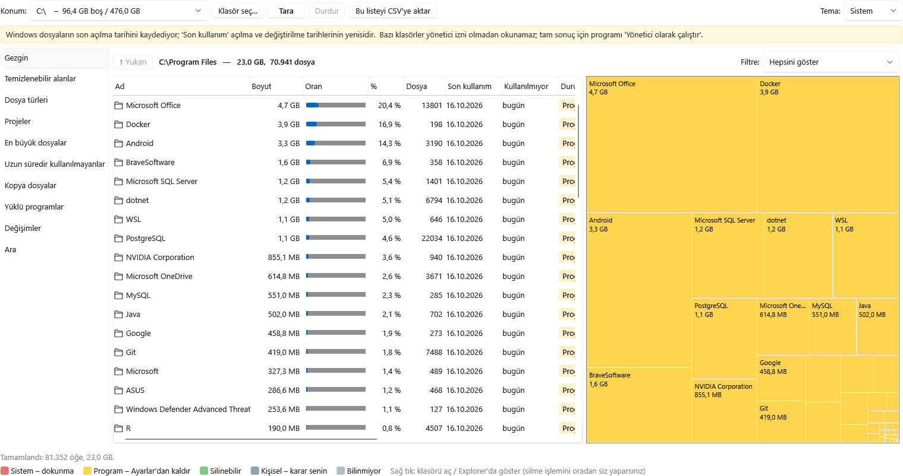
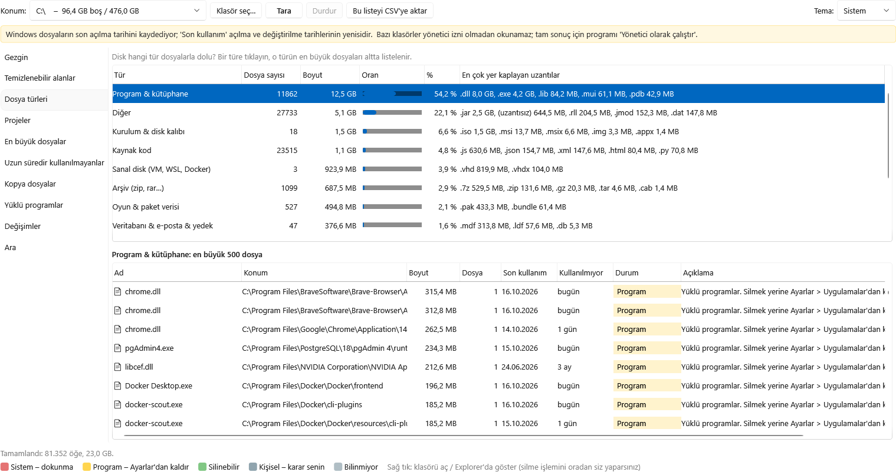
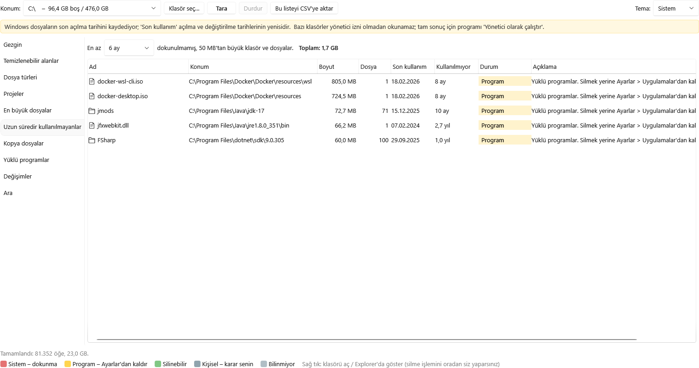
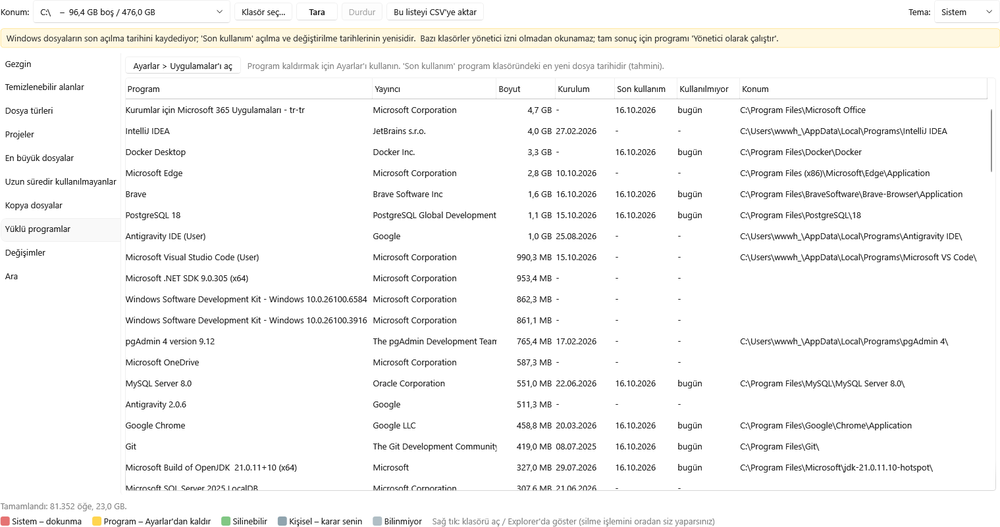
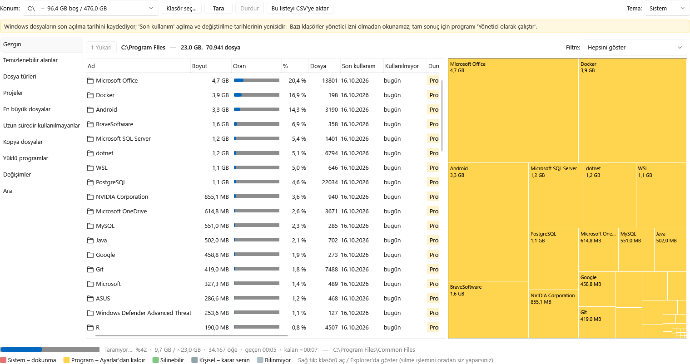
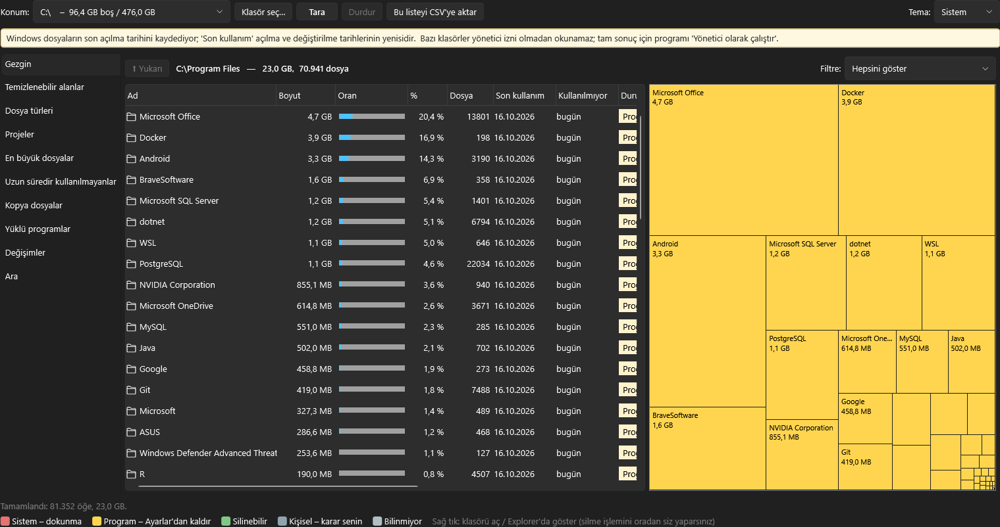

# Disk Radar

**English** · [Türkçe](README.tr.md)

A Windows disk space analyzer that answers three questions: **what is taking up space, how long has it been unused, and is it safe to delete?**

Disk Radar never deletes or moves anything. It shows you the facts and opens the folder in Explorer — you decide and delete by hand.



## Features

- **Fast scan** of any drive or folder, with a progress bar, elapsed time and estimated time remaining.
- **Safety labels** on every file and folder, each with a short explanation of what it is and how to clean it:
  - 🔴 **System** – don't touch (Windows, page/hibernation files, WinSxS…)
  - 🟡 **Program** – uninstall from *Settings › Apps* instead of deleting
  - 🟢 **Cleanable** – temp files, caches, Recycle Bin, Windows Update leftovers, build output
  - ⚪ **Personal** – your own files, your call
- **Last used** date and "unused for" duration for everything.
- **Explorer + treemap** – browse folders in a table next to a squarified treemap; filter by cleanable, unused for a year, files only, and more.
- **Cleanable areas** – all safe-to-clean locations in one list with a total.
- **File types** – how much space goes to videos, photos, archives, ISOs, virtual disks, code…
- **Projects** – finds .NET, Node.js, Java, Python, Rust, Go… projects and their regenerable folders (`bin`, `obj`, `node_modules`, `.venv`, `target`…).
- **Largest files** and **unused for a long time** (3 months – 5 years).
- **Duplicate finder** – byte-identical files (size → first 64 KB → full SHA-256).
- **Installed programs** – size, install date and estimated last use, with a shortcut to *Settings › Apps*.
- **Changes over time** – every scan is saved; a chart and a list show which folders grew or shrank.
- **Search** by name, **CSV export** of any list, **light/dark theme**, and the last scan opens **instantly** on startup.

## Screenshots

| File types | Unused for a long time |
|---|---|
|  |  |

| Installed programs | Scan in progress |
|---|---|
|  |  |



> The UI is in Turkish.

## Download & run

Grab `DiskRadar.exe` from the [Releases](../../releases) page. It is a single self-contained file — no installation and no .NET runtime needed.

For complete results, right-click it and choose **Run as administrator**; some system folders can't be read otherwise.

## Build from source

Requirements: Windows 10/11 and the [.NET 9 SDK](https://dotnet.microsoft.com/download/dotnet/9.0).

```bash
cd DiskRadar
dotnet run -c Release
```

Build the single-file executable into `dist/`:

```bash
DiskRadar\publish.cmd
```

## Notes

- If Windows' "last access" tracking is disabled, *last used* falls back to the last **modified** date. A banner in the app tells you which one is in effect.
- The *last used* date of installed programs is an estimate (newest file in the program folder).
- Scan history and the last-scan cache are stored in `%LOCALAPPDATA%\DiskRadar`.

## Tech

C# · WPF · .NET 9 (Fluent theme) · no external packages.

## License

See [LICENSE](LICENSE).
